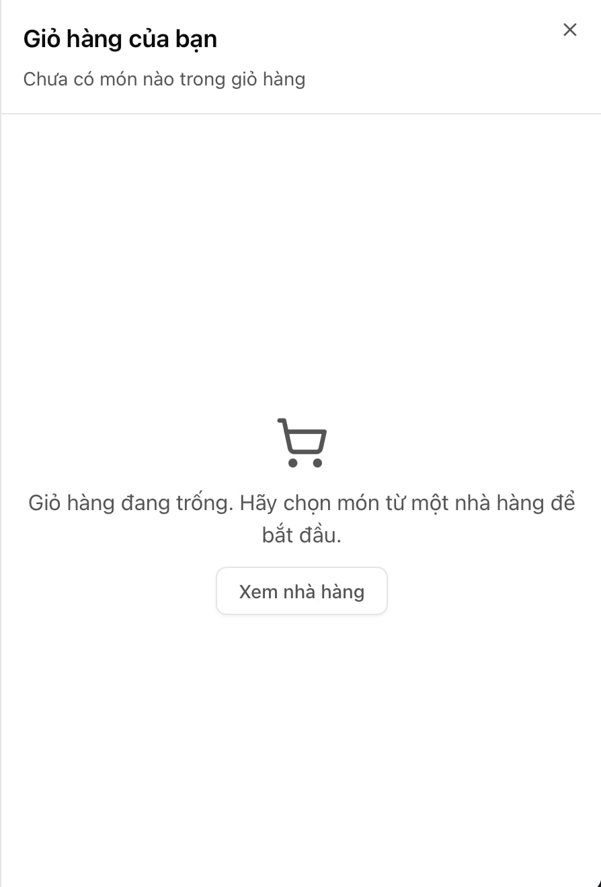
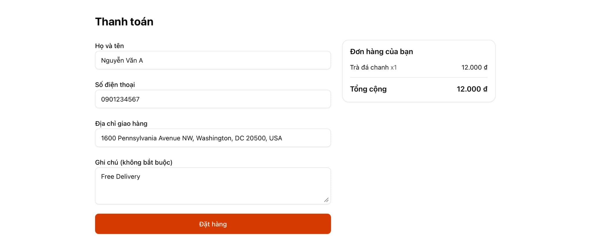
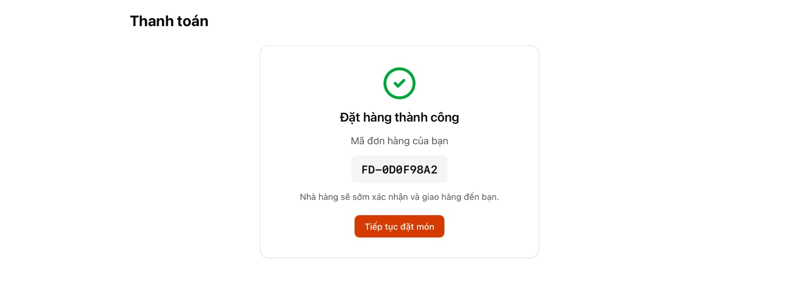

# Food Delivery - Frontend

Ứng dụng đặt đồ ăn trực tuyến, phần Frontend (Buổi 1 đến Buổi 3). Người dùng xem danh sách nhà hàng,
chọn món, thêm vào giỏ hàng và đặt hàng qua form thanh toán. Dự án dùng mock data và mock API,
Backend sẽ được xây dựng ở Buổi 4.

## Ảnh chụp màn hình

| Trang chủ | Trang nhà hàng |
|---|---|
|  |  |

| Giỏ hàng | Thanh toán |
|---|---|
|  |  |

| Đặt hàng thành công |
|---|
|  |

## Công nghệ sử dụng

| Nhóm | Công nghệ |
|---|---|
| Framework | Next.js 16 (App Router), React 19, TypeScript |
| Giao diện | Tailwind CSS v4, shadcn/ui, lucide-react, Sonner (toast) |
| State | Zustand + Persist (lưu giỏ hàng vào localStorage) |
| Form | React Hook Form, Zod, @hookform/resolvers |
| Hạ tầng | pnpm, Docker, GitHub Actions (kiểm tra bài + Lighthouse CI) |

## Cấu trúc thư mục

```text
.
├── apps/
│   ├── web/                  # Frontend (Next.js)
│   │   ├── public/images/    # Ảnh SVG của nhà hàng và món ăn
│   │   └── src/
│   │       ├── app/          # Route: /, /restaurant/[id], /checkout, /api/orders
│   │       ├── components/   # ui (shadcn), layout, cart, restaurant, checkout
│   │       ├── data/         # Mock data nhà hàng và món ăn
│   │       ├── schemas/      # Zod schema (checkout, order, user profile)
│   │       ├── store/        # Zustand cart store
│   │       └── ...           # hooks, lib, types
│   └── api/                  # Backend (làm ở Buổi 4)
├── docs/                     # PRD, kiến trúc, quy trình Git, ảnh chụp màn hình
├── scripts/check-repo.mjs    # Bộ tự kiểm tra bài
├── docker-compose.yml
└── AGENTS.md                 # Hướng dẫn cho OpenCode / AI agent
```

## Yêu cầu môi trường

- Node.js 20 trở lên (khuyên dùng bản LTS mới nhất)
- pnpm 10 (`npm i -g pnpm`)
- Git
- Docker Desktop (chỉ cần khi chạy bằng Docker)

## Cách chạy

Chạy ở môi trường phát triển:

```bash
cd apps/web
pnpm install
pnpm dev
```

Mở http://localhost:3000. Chạy bản production:

```bash
cd apps/web
pnpm build
pnpm start
```

Chạy bằng Docker (ở thư mục gốc của repo):

```bash
docker compose up -d --build
docker compose down   # dừng và xóa container
```

## Tự kiểm tra bài

```bash
node scripts/check-repo.mjs            # kiểm tra nhanh
node scripts/check-repo.mjs --build    # kiểm tra và chạy thêm pnpm build
node scripts/check-repo.mjs --docker   # chạy docker compose up -d rồi down
```

Xem thêm trong `README-CHECK.md`.

## Server Component và Client Component

Dự án dùng App Router của Next.js nên mặc định mọi component là **Server Component**:
chạy trên server, gửi HTML đã render sẵn xuống trình duyệt và không tốn JavaScript phía client.
Chỉ khi component cần **tương tác** (sự kiện bấm, state, hook, localStorage) mới thêm `"use client"`
để thành **Client Component**.

| Component | Loại | Lý do |
|---|---|---|
| `app/page.tsx` (trang chủ), `RestaurantCard` | Server | Chỉ hiển thị dữ liệu, không có tương tác |
| `app/restaurant/[id]/page.tsx`, `DishCard` | Server | Đọc mock data và render danh sách món |
| `Header`, `Footer` | Server | Chỉ có link tĩnh |
| `AddToCartButton` | Client | Có `onClick` và gọi Zustand store |
| `CartDrawer`, `CartBadge` | Client | Đọc giỏ hàng từ Zustand, có state mở/đóng |
| `CheckoutForm` | Client | React Hook Form cần state và sự kiện |
| `error.tsx` | Client | Error boundary của Next.js bắt buộc là Client Component |

Nguyên tắc: giữ `"use client"` ở càng sâu (càng gần lá của cây component) càng tốt.
Ví dụ `DishCard` là Server Component, chỉ riêng nút bên trong nó là Client Component.

## Quy trình Git

Mỗi task làm trên một nhánh `feat/...`, commit theo
[Conventional Commits](https://www.conventionalcommits.org/) và gộp vào `main` qua Pull Request.
Chi tiết từng bước xem `docs/GIT_WORKFLOW.md`.

## Tài liệu

- [PRD](docs/PRD.md): yêu cầu sản phẩm
- [Kiến trúc](docs/architecture.md): cấu trúc, luồng dữ liệu
- [Quy trình Git](docs/GIT_WORKFLOW.md)
