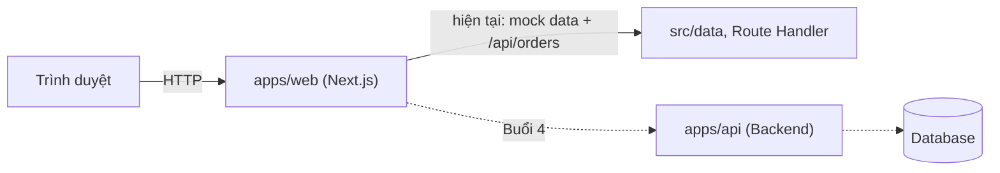
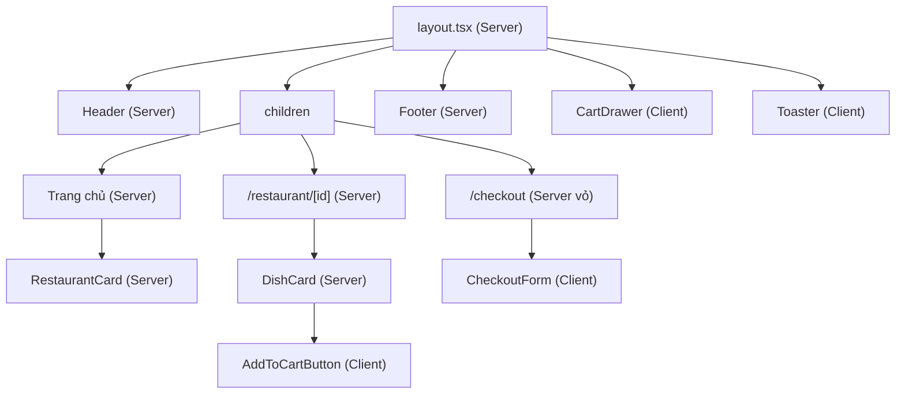
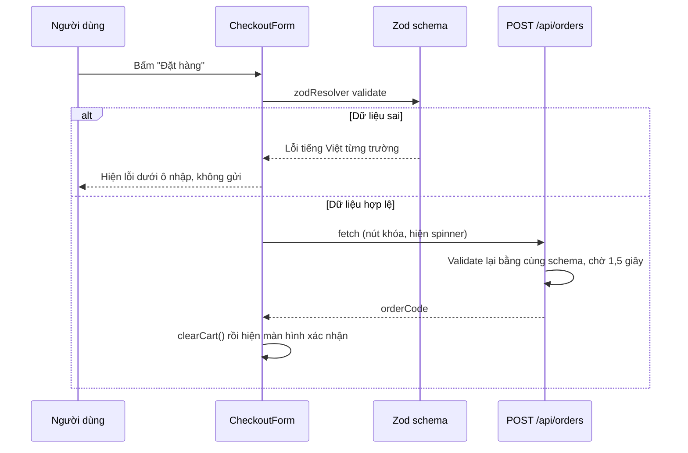

# Kiến trúc

## Tổng quan

Hiện tại toàn bộ chạy trong `apps/web`. Mọi truy cập dữ liệu đi qua `src/data/index.ts` nên khi có Backend
chỉ cần thay phần ruột của các hàm trong file đó.

## Ranh giới Server và Client Component

Nguyên tắc: Server Component là mặc định; `"use client"` chỉ dùng ở các lá cần tương tác.

## Luồng giỏ hàng

1. `AddToCartButton` gọi `addItem(dish)` trên Zustand store và hiện toast.
2. Store cập nhật `items`; middleware `persist` ghi vào localStorage (key `food-delivery-cart`).
3. `CartDrawer` đọc `items` qua selector (`selectTotalQuantity`, `selectTotalPrice`) nên badge đổi số ngay.
4. Server không đọc được localStorage, nên các component giỏ hàng dùng `useIsClient()` để chỉ hiển thị
   dữ liệu giỏ sau khi hydrate, tránh lỗi hydration mismatch.

## Luồng đặt hàng

Cùng một schema (`src/schemas/checkout.ts`) được dùng ở client để báo lỗi sớm và ở server để bảo vệ,
vì không bao giờ được tin dữ liệu từ trình duyệt.

## Quyết định kỹ thuật

| Quyết định | Lý do |
|---|---|
| Mock API bằng Route Handler | Không cần thêm thư viện, chạy cùng `next dev` |
| Ảnh SVG cục bộ trong `public/` | Không phụ thuộc mạng, Lighthouse ổn định |
| Font hệ thống | Không tải font ngoài, giảm thời gian load |
| Sheet (shadcn) làm Cart Drawer | Radix Dialog lo sẵn focus, phím Esc và aria |
| `apps/web` là project pnpm độc lập | Đơn giản; lockfile nằm ở `apps/web/pnpm-lock.yaml` |
